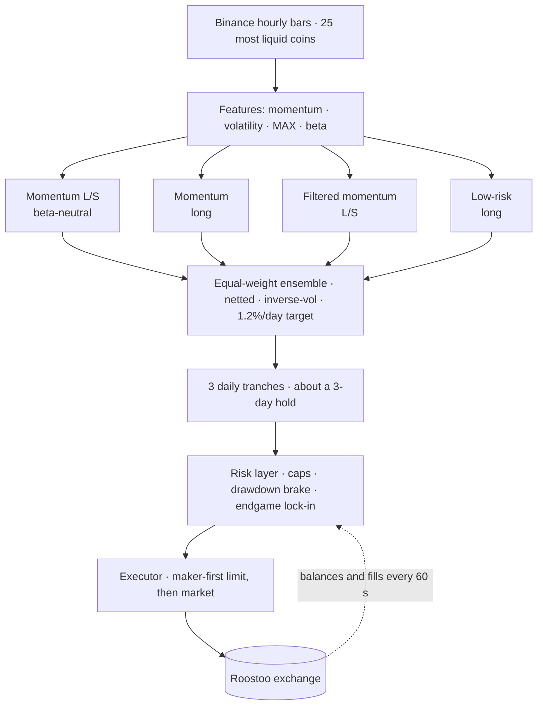
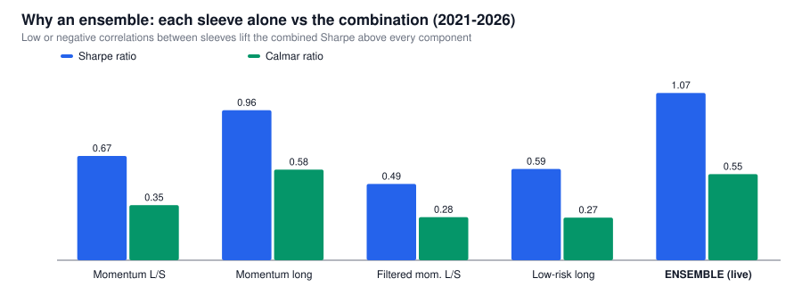
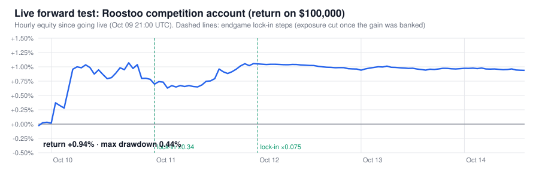
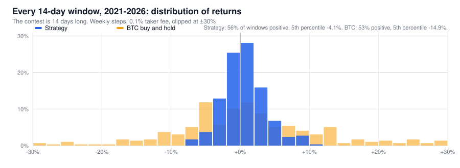

# Roostoo-QT

### A risk-first, fully autonomous crypto trading bot: momentum and low-risk anomalies, hedged and cost-aware

[](https://github.com/wildwolf07/Roostoo-QT/actions/workflows/tests.yml)


**Team150-negExp (MSU)** · APAC Quant Trading Hackathon · Roostoo × Susquehanna × AWS · India region

Once a day the bot ranks the 25 most liquid coins on Roostoo by medium-term momentum and by risk.
It holds an **equal-weight ensemble of four long/short and long-only sleeves**, sizes every position
by volatility, and trades maker-first. The contest scores portfolios on Sortino, Sharpe and Calmar,
so the whole system is built for one thing: **a smooth, positive equity curve with small drawdowns.**

---

## The numbers

Live configuration, hourly simulation on Binance data, **0.1% taker fee charged on every fill**.
This table is regenerated by `make results`; the full tables are in
[`results/backtest/SUMMARY.md`](results/backtest/SUMMARY.md).

| | Strategy, 2021–26 | BTC, 2021–26 | Strategy, **out-of-sample** 2025–26 | BTC, 2025–26 |
|---|---|---|---|---|
| Annual return (CAGR) | +15.6% | +14.8% | **+28.5%** | −16.7% |
| Volatility | **14.5%** | 55.9% | **14.3%** | 41.5% |
| Sharpe | **1.07** | 0.53 | **1.83** | −0.23 |
| Sortino | **1.60** | 0.78 | **2.86** | −0.33 |
| Calmar | **0.55** | 0.19 | **1.94** | −0.31 |
| Max drawdown | **28.3%** | 77.2% | **14.7%** | 53.7% |
| Worst day | **−3.4%** | −15.4% | **−3.2%** | −14.0% |
| Beta to BTC | **0.16** | 1.00 | **0.22** | 1.00 |

- **The same return as BTC, with a quarter of the volatility, double the Sharpe and a third of the drawdown.**
- **The unseen bear market:** 2021–22 was never used for any design decision. The strategy made **+19.8%** while BTC fell **54%**.
- **Crashes:** LUNA −6.5% (market −30%), 3AC −4.1% (−26%), FTX −1.5% (−22%), the Oct-2025 liquidation cascade −2.0% (−20%).
- **At the contest's length:** across 295 fourteen-day windows, the median max drawdown is **2.4–2.9%** and the out-of-sample median composite score is **4.0**.
- **Live:** trading the competition account since 2026-10-09: **+0.94%** with a **0.44%** max drawdown,
  99.95% API success and more than half of all spot fills at the maker fee (section 2).


---

## Contents
1. [How it works](#1-how-it-works)
2. [Live forward test](#2-live-forward-test)
3. [Strategy in detail](#3-strategy-in-detail)
4. [Evidence that it is robust](#4-evidence-that-it-is-robust)
5. [Is it viable in a real market?](#5-is-it-viable-in-a-real-market)
6. [Risk management](#6-risk-management)
7. [Engineering](#7-engineering)
8. [Methodology and reproduction](#8-methodology-and-reproduction)
9. [Setup](#9-setup)
10. [Repository map](#10-repository-map)
11. [Compliance](#11-compliance)

---

## 1. How it works



**Three ideas carry the strategy:**

1. **Trends persist over days; reversals rule over hours.** Coins that outperformed over the past
   7–14 days keep outperforming for the next 1–3 days, while 1–24 hour moves mean-revert. Our first,
   fast design lost money to exactly that reversal effect. So we trade the slow effect and hold for
   about 3 days.
2. **Calm coins are underpriced.** Lottery-like, volatile, high-beta coins are overpriced on
   average, so owning the calm ones earns better risk-adjusted returns. *Shorting* the lottery coins
   loses money, because rare pumps dominate a short book. So the low-risk sleeve is long-only, and
   the filtered sleeve only shorts calm losers.
3. **Different sleeves win in different regimes.** The sleeves' daily returns are weakly or even
   negatively correlated (down to −0.16), so the ensemble's Sharpe (1.07) beats every individual
   sleeve (0.49–0.96).



---

## 2. Live forward test



| | Live result |
|---|---|
| Account | Roostoo competition account, $100,000 start. Live since 2026-10-09 21:51 UTC; the contest window is Oct 4 12:00 → Oct 18 12:00 UTC, flat cash before we went live |
| Result (Oct 14, 14:00 UTC) | **+0.94%**, **max drawdown 0.44%**, against a backtest median 14-day max drawdown of 2.4–2.9% |
| Contest-day returns | +0.95%, −0.26%, +0.34%, −0.05%, −0.01% (then about flat under the lock-in) |
| Execution | 105 orders, 89 filled; **30 of 55 spot fills paid the 0.05% maker fee**; total fees 0.159% of equity |
| Reliability | **99.95%** of 20,553 API calls successful; no manual intervention; every order logged with its signal reason |
| Risk control | Endgame lock-in steps on Oct 11 (×0.34) and Oct 12 (×0.075): gross exposure 64% → 23% → 5%, exactly as designed |
| Raw data | [`results/forward_test/`](results/forward_test/): day-by-day table and hourly equity, exported read-only from the bot's audit log |

On Oct 11 the market dipped overnight and then rallied. During the evening dip our hedged book
*rose* while long-only books fell. That is the long/short sleeves doing their job.

We expect live performance to be **below** the backtest. The deflated Sharpe ratio (section 4)
says part of the backtest edge is selection luck. A few live days cannot measure an edge, but they
do show that the engine, the execution and the risk controls behave exactly as designed.

---

## 3. Strategy in detail

**Signals** (hourly bars; identical code in research and live, [`bot/strategy/signals.py`](bot/strategy/signals.py))

| Feature | Definition | Role |
|---|---|---|
| `mom` | mean of the 168h and 336h log returns, each divided by `vol72 · √L` | risk-adjusted 7–14 day trend |
| `vol72` | std of hourly log returns over 72h | risk |
| `max24` | largest hourly return over the last 24h | lottery-likeness |
| `beta` | 336h rolling beta of hourly returns to BTC | market exposure |

Each feature is z-scored across the universe and clipped at ±3.

**Sleeves** (4 coins per side, inverse-volatility weights)

| Sleeve | Long | Short | Purpose |
|---|---|---|---|
| Momentum L/S | top-4 `mom` | bottom-4 `mom`, scaled so the short leg's beta equals the long leg's | pure trend premium, zero beta |
| Momentum long | top-4 `mom` | none | trend premium plus a modest long tilt |
| Filtered momentum L/S | top-4 `mom` with `max24` rank ≤ 70% | bottom-4 `mom` with `vol72` rank ≤ 60% | no lottery longs, no pump-prone shorts |
| Low-risk long | top-4 of −z(`vol72`) − z(`max24`) − z(`beta`) | none | low-vol / lottery / betting-against-beta anomalies |

**Portfolio construction**
- **Netting:** the four sleeves are averaged *before* trading, so opposite views on a coin cancel
  instead of paying fees twice.
- **Tranching:** the target is the average of the targets computed now, 24h ago and 48h ago. A third
  of the book is re-aimed each day, giving a ~3-day hold and smooth turnover (about 0.15–0.2× equity
  a day).
- **Sizing:** volatility target of 1.2% a day; at most 30% of equity per coin; gross exposure ≤ 95%;
  shorts fully collateralised (Roostoo `/v6`); no leverage.
- **Universe:** the top 25 of 29 whitelisted coins by Roostoo 24h volume, re-selected daily. PEPE
  and SHIB are excluded for their 18–25 bp spreads.

**Execution:** reduce first (SELL / SHORT_CLOSE), then add (BUY / SHORT_OPEN). Spot orders go out as
LIMIT at the best bid or ask (0.05% maker fee). After 3 minutes, the remainder is re-planned from fresh
exchange state and sent at market.

| Parameter | Value | Why |
|---|---|---|
| Lookbacks | 168h, 336h | positive rank IC at 1–3 day horizons in- and out-of-sample; 1–24h lookbacks mean-revert (t ≈ −14) |
| Holding period | ~3 days | the alpha-decay curve is front-loaded over 3 days; shorter holds pay more fees than they earn |
| Volatility target | 1.2% a day | best 14-day composite among 1.2 / 1.6 / 2.0% |
| Coins per side | 4 | 3, 4 and 5 are within noise; we took the middle of the plateau |
| Universe size | 25 | Sharpe rises with breadth: 0.89 → 1.14 → 1.27 for 15 / 20 / 25 coins (Grinold's fundamental law) |

---

## 4. Evidence that it is robust

**4.1 Three periods, one never seen during design**

| Period | Strategy | BTC | Equal-weight market |
|---|---|---|---|
| 2021-02 → 2022-12, **unseen** (LUNA, 3AC, FTX) | **+19.8%**, Sharpe 0.70, max DD 28.3% | −54.1%, max DD 77.2% | −12.5%, max DD 82.6% |
| 2023-01 → 2025-05, in-sample | +35.4%, Sharpe 0.96, max DD 16.9% | +533%, max DD 32.3% | +278%, max DD 63.6% |
| 2025-06 → 2026-10, **out-of-sample** | **+41.2%, Sharpe 1.85**, max DD 14.7% | −21.0%, max DD 53.7% | −15.2%, max DD 64.8% |

The strategy lags in strong bull markets (2023–24), because about half the book is hedged. That is
the price of the crash behaviour below.

**4.2 Scored the way the contest scores:** every 14-day window, in weekly steps, with
0.4 Sortino + 0.3 Sharpe + 0.3 Calmar.

| Period | Windows | Median return | % positive | Median max DD | 95th pct max DD | Median composite |
|---|---|---|---|---|---|---|
| 2021–22 unseen | 100 | +0.57% | 56% | 2.9% | 6.3% | 2.73 |
| 2023–25 in-sample | 126 | +0.51% | 61% | 2.6% | 5.8% | 2.84 |
| 2025–26 out-of-sample | 69 | +0.70% | 64% | 2.4% | 5.1% | 4.00 |



**4.3 Crashes**


**4.4 Statistics and overfitting control** (2023–26 research panel)
- **Probabilistic Sharpe ratio 99.2%. Deflated Sharpe ratio 64–71%** after correcting for every
  variant we tried (about 40–80), plus skew and fat tails (Bailey & López de Prado).
- **Stationary block bootstrap:** Sharpe 1.28, 95% CI [0.19, 2.34], P(Sharpe ≤ 0) = 1.1%. The edge
  is very likely positive, but its size is uncertain, and we say so.
- **Plateaus, not peaks:** the live configuration ranks 5th of 15 one-at-a-time variants.
- **No survivorship bias:** on a 72-coin point-in-time universe that includes later-delisted coins
  (EOS, FTM, MKR, WAVES, MATIC, RNDR, FTT), the same strategy does *better* (Sharpe 1.55 vs 1.08).
- **Breadth:** more coins means more independent bets and a higher Sharpe; coins per side barely matter.


**4.5 What we rejected, and why.** Each of these is recorded with its numbers in
[DECISIONS.md](DECISIONS.md):
- the fast trend strategy with a regime gate (our v0; it lost money);
- short-term reversal and BTC lead-lag (t > 10, but the edge is smaller than fees);
- funding-rate signals (they worked in-sample only);
- low-risk long/short (rank IC ≠ P&L);
- per-coin stops (Sharpe 1.27 → 0.75);
- tight drawdown overlays (whipsaw);
- volatility-managed scaling;
- residual momentum and a larger whitelist (both failed 2021–22).

**4.6 The bot trades what we tested.** [`research/parity_check.py`](research/parity_check.py)
recomputes every sleeve with the live code at random historical dates: the maximum weight difference
is 8e-17. [`backtest/engine.py`](backtest/engine.py) replays the live strategy, risk and order code
hour by hour.

---

## 5. Is it viable in a real market?

| Question | Answer |
|---|---|
| Does the edge survive costs? | Yes (2023–26 research panel): Sharpe 1.52 at a 0.05% fee, 1.27 at 0.1%, 0.75 at 0.2%. Break-even is about **0.35%** per unit traded, against ~0.1% taker fees and 1–5 bp spreads on these coins at major venues |
| How much capital can it run? | At $100k the median order is 0.0015% of the coin's daily volume. At $10M the 95th percentile order reaches ~2% of daily volume in the smallest coins, so **~$5–10M** before liquidity-weighted sizing is needed |
| Does it need speed? | No. One rebalance a day; no order-book race, HFT, market making or arbitrage |
| How would shorts work? | Through perpetual futures. Funding has mostly been paid by longs to shorts, so the short legs would usually *earn* carry. This is venue-dependent and **not modelled**, which is conservative |
| What can go wrong? | A long grinding bear market (2022: −19.6%); momentum crashes in sharp reversals; an edge of uncertain size; exchange and custody risk |
| What would we add for real capital? | Liquidity-weighted position limits, a funding and borrow cost model, multi-venue execution, the bear-market filter as a switchable overlay, quarterly re-validation out of sample |

---

## 6. Risk management

| Control | Rule | Evidence |
|---|---|---|
| Volatility target | gross exposure sized for ~1.2% expected daily portfolio volatility | best 14-day composite of the targets tested |
| Concentration | ≤ 30% per coin; 4 coins per side per sleeve; 25-coin universe | worst single coin-day in the backtest: −2.1% of equity |
| Leverage | none; gross ≤ 95%; shorts fully collateralised | — |
| Drawdown brake | catastrophe-only: linear de-risking from 6% to 12% drawdown (down to ×0.25) | tighter brakes whipsaw and cut the median score in both periods |
| Per-coin stops | built, tested, **disabled** | every setting lowered Sharpe and none cut max drawdown |
| **Endgame lock-in** | from Oct 10: exposure ×1 → ×0.075 as the banked contest return goes 0 → +0.25%; back to full size only if the gain is gone | closed-form optimum and simulation ([docs/ENDGAME.md](docs/ENDGAME.md)) |
| Taper | ×0.5 for the final ~36 hours | — |
| Operational | price sanity check (±3% of the ticker), order-size cap, stale orders cancelled on restart, data fallbacks with a cache, bounded retries, a daily safety-net trade | unit-tested |

**Why the lock-in.** The contest's ratios are computed over a fixed window. Once a gain is banked,
extra risk grows the denominators (volatility, downside deviation, max drawdown) faster than the
numerators. The optimal remaining exposure has a closed form:

> **k\* = (μ / s²) · (Q / S)**: the strategy's Kelly leverage times the realised variance per unit
> of banked profit.

We checked it on 5,350 historical stretches under four readings of the formula
([docs/ENDGAME.md](docs/ENDGAME.md); literature: Brown, Harlow & Starks 1996; Browne 1999;
Basak, Pavlova & Shapiro 2007). It is the evaluation-window version of P&L-based risk budgets on
trading desks. **The core strategy (sections 3–5) is what we would run with real capital**; the
lock-in is a mandate-specific overlay set by how this contest is scored.

---

## 7. Engineering

| Module | Responsibility |
|---|---|
| [`bot/main.py`](bot/main.py) | Autonomous scheduler: 60-second snapshots, daily rebalance at 00:01 UTC with bounded retries, 10:00 UTC safety net, persisted state |
| [`bot/strategy/signals.py`](bot/strategy/signals.py) | Pure functions shared by the live bot and both backtesters: features, sleeves, ensemble, tranching |
| [`bot/risk/risk_manager.py`](bot/risk/risk_manager.py) | Drawdown brake, endgame lock-in, taper (CPPI, 24h loss limit and stops available, disabled by research) |
| [`bot/execution/executor.py`](bot/execution/executor.py) | Targets → orders: precision rounding, deadbands, long and short legs, maker-first with market fallback, cash checks |
| [`bot/api/roostoo_client.py`](bot/api/roostoo_client.py) | HMAC-SHA256 signing, rate limiter (≤ 20 calls/min vs the 30 limit), retries with backoff, `Success`-flag handling |
| [`bot/data/market_data.py`](bot/data/market_data.py) | Binance klines with 4 fallback hosts and a cache; universe selection by Roostoo volume |
| [`bot/storage/db.py`](bot/storage/db.py) | SQLite audit trail: every API call, order (with its signal reason), decision and equity snapshot |
| [`bot/config.py`](bot/config.py) | Every tunable in one place, each annotated with the study that set it |

- **Restart-safe:** the portfolio is rebuilt from the exchange every minute, never from memory.
- **Tested:** 31 unit tests (signing, signals, ensemble, risk, lock-in, metrics, order planning, shorts,
  scheduler, data fallback); CI on Python 3.9 and 3.12.
- **Deployed from commits only:** `deploy/deploy.sh` checks out a commit, runs the tests, then
  restarts the service.

---

## 8. Methodology and reproduction

- **Data:** Binance hourly bars (Roostoo streams Binance prices), 2021-01 → 2026-10, plus funding,
  premium and order flow for signal research.
- **Splits:** in-sample 2023-01 → 2025-05; out-of-sample 2025-06 → 2026-10; **2021–22 unseen**.
- **Costs:** every simulated fill pays the 0.1% taker fee. The event-driven engine adds slippage.
- **Rule for any strategy change:** it must improve **both** periods, sit on a plateau and be explainable.
- **Forward tests:** dry runs on the Roostoo test account before each release, then the
  competition account.

```bash
make data       # Binance hourly data 2021 → now (public API, no keys)
make results    # results/backtest/: tear sheet, equity, years, 14-day windows, crashes, sleeves
make charts     # docs/img/*.svg from results/
make parity     # live code == research code (max difference 8e-17)
make backtest   # event-driven backtest of the live code with 14-day windows
make test       # 31 unit tests
```

Every study has a script; [research/README.md](research/README.md) maps each question to its
script and answer.

---

## 9. Setup

```bash
git clone https://github.com/wildwolf07/Roostoo-QT.git && cd Roostoo-QT
python3 -m venv .venv && source .venv/bin/activate
pip install -r requirements.txt          # the live bot (requests, numpy, pandas)
pip install -r requirements-research.txt # research and backtests (adds pyarrow)
cp .env.example .env                     # API keys; MODE=paper|test|live
ln -sf ../../scripts/check_secrets.sh .git/hooks/pre-commit   # hook that blocks secrets
make test && make paper                  # tests, then one dry-run decision cycle (no orders)
python -m bot.main                       # run continuously
```

On AWS EC2: `sudo bash deploy/setup_ec2.sh <repo-url>`, add keys to `/opt/roostoo-bot/.env`, then
`sudo systemctl enable --now roostoo-bot`. Updates: `sudo bash /opt/roostoo-bot/deploy/deploy.sh`.
Operations guide: [docs/RUNBOOK.md](docs/RUNBOOK.md).

---

## 10. Repository map

```
bot/            live trading bot: scheduler, signals, risk, execution, API client, audit log
backtest/       event-driven hourly backtester running the live code
research/       data download, signal lab, portfolio studies, robustness, statistics, endgame, results
results/        generated backtest results and the live forward-test export
tests/          31 unit tests (CI: Python 3.9 and 3.12)
scripts/        read-only daily report, live export, health check (test key only), decision tools
deploy/         EC2 setup, systemd unit, commit-based deploy
docs/           ENDGAME (risk derivation), FAQ, RUNBOOK, presentation outline, original plan, charts
```

| Document | Contents |
|---|---|
| [RESEARCH.md](RESEARCH.md) | The full research notebook: literature, IC tables, every study and its numbers |
| [DECISIONS.md](DECISIONS.md) | Every live change and every rejected idea, with evidence |
| [docs/ENDGAME.md](docs/ENDGAME.md) | Contest-endgame risk: derivation, simulation, audit, literature |
| [docs/FAQ.md](docs/FAQ.md) | The hardest questions about the strategy, with evidence-backed answers |
| [docs/RUNBOOK.md](docs/RUNBOOK.md) | Operations: schedule, daily checks, deploys, what is normal |
| [research/README.md](research/README.md) | Index: question → script → answer |
| [research/AGENDA.md](research/AGENDA.md) | Chronological research log |

---

## 11. Compliance

- **Autonomous:** every trade comes from the bot. There are no manual API calls on the competition
  account; even our health check uses the test key.
- **Traceable:** every strategy change is a commit, and the server is updated only from commits.
  Every order is logged with the signal reason that produced it, and every API call with its success
  status.
- **No HFT, market making, latency arbitrage or leverage:** one strategy rebalance a day. Limit
  orders are used only to pay the lower maker fee on our own directional trades.
- **Active every day:** about 10 orders a day even with the small locked-in book, and a 10:00 UTC
  safety net guarantees a trade under any day convention.
- **Secrets:** API keys live only in `.env` (gitignored), and a pre-commit hook blocks them.
