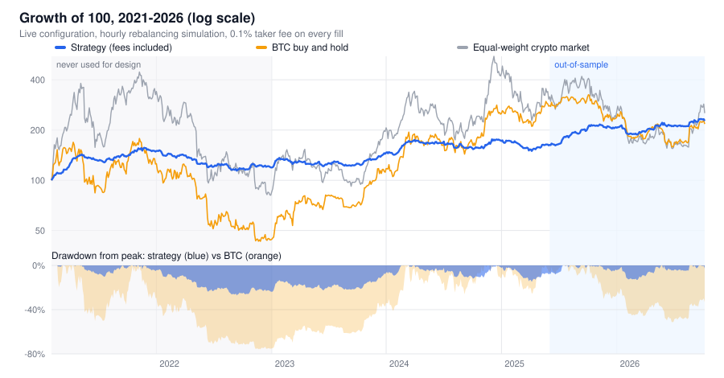
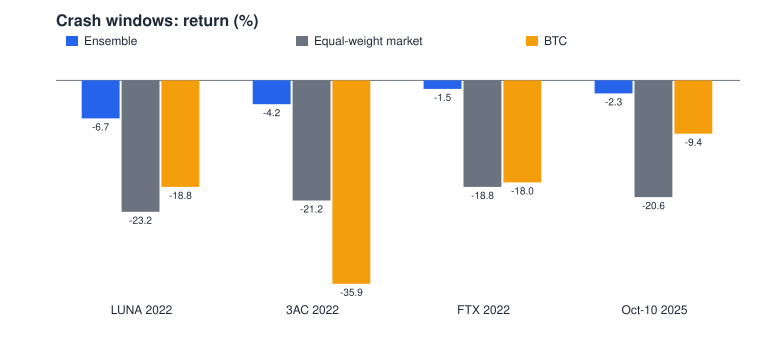
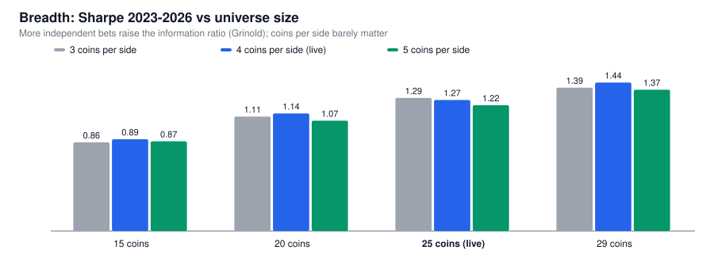

# Roostoo-QT — Risk-First Autonomous Crypto Trading Bot

[](https://github.com/wildwolf07/Roostoo-QT/actions/workflows/tests.yml)

**Team150-negExp** · Autonomous crypto trading bot for the Roostoo mock exchange.

> One-line thesis: the competition is scored mostly on *downside-aware* ratios
> (0.4 Sortino + 0.3 Sharpe + 0.3 Calmar), so we built a bot that optimises for a
> **smooth, positive equity curve with small drawdowns**, not for maximum return.

---

## 1. Project overview

| | |
|---|---|
| Style | Directional, low-turnover: daily rebalance of a long/short book |
| Universe | 25 most liquid of 29 whitelisted coins (by Roostoo 24h volume) |
| Core idea | Equal-weight **ensemble of 4 sleeves**: (1) cross-sectional momentum long/short, beta-neutral; (2) long-only momentum; (3) *filtered* momentum (no lottery-like longs, only calm shorts); (4) low-risk long-only (low volatility / low MAX / low beta). Tranched over 3 days, volatility-targeted, wrapped in automatic drawdown controls |
| Execution | Maker-first limit orders (0.05% fee) with market fallback; deadbands to cut turnover |
| Risk | Volatility targeting, ≤30% per coin, ≤95% gross, no leverage, catastrophe-only drawdown brake (6–12%); stops/CPPI removed after tests showed they whipsaw |
| Autonomy | Runs 24/7 on AWS EC2 under systemd; no manual input of any kind |

### Results at a glance (backtests include fees; details in [RESEARCH.md](RESEARCH.md))



| Period | Ensemble | BTC |
|---|---|---|
| 2023-01 → 2026-10 (design + out-of-sample) | **+84%, Sharpe 1.27, max DD 16.9%** | buy-and-hold with ~50% drawdowns |
| 2021-02 → 2022-12 (never used for design) | **+19.8%, Sharpe 0.70** | **−49.2%** |
| 14-day windows, out-of-sample | median composite 4.0; 67% of windows positive | |
| Survivorship test (72-coin point-in-time universe incl. delisted coins) | Sharpe 1.55 vs 1.08 on survivors: no survivorship inflation | |
| Statistical confidence | P(true Sharpe > 0) = 99.2% (PSR); 64–71% after deflating for every variant we tried (DSR) | |

We expect live performance to come in **below** the backtest. The deflated Sharpe says
part of the backtest's 1.27 is selection luck, and every result here is conservative on fees
(taker rate on every fill).





### How we arrived at this strategy (full evidence in [RESEARCH.md](RESEARCH.md); every change and rejected idea in [DECISIONS.md](DECISIONS.md))
1. **Literature first, then our own data.** We reviewed the crypto return-predictability
   literature (momentum, reversal, lottery/MAX, low-volatility, betting-against-beta, funding,
   order flow, lead-lag, seasonality) and tested every effect on 3.8 years of hourly data for
   the 31 coins tradable on Roostoo, with a strict in-sample / out-of-sample split.
2. **What survived costs.** Short-horizon effects (reversal, BTC lead-lag) are statistically
   strong (t > 10) but smaller than fees. Medium-term **momentum** and the **low-risk anomaly**
   survive costs at a ~3-day holding period.
3. **IC is not P&L.** Shorting high-volatility "lottery" coins loses money despite a strongly
   negative IC (rare pumps dominate), so low-risk is harvested **long-only**, and the filtered
   momentum sleeve only shorts *calm* losers.
4. **Diversify across regimes.** Momentum works in the current regime; low-risk works across
   regimes. The equal-weight ensemble had the best Sharpe (0.73), lowest drawdown and was
   positive in **every** year from 2023 to 2026 (fees included).
5. **Fees are the silent killer.** Tranching, deadbands, sleeve netting and maker-first orders
   keep turnover at ~0.18× equity per day.

## 2. Trading engine and architecture

```
 every 60 s   Roostoo: ticker + balance + short positions
              └─► Portfolio rebuilt from the exchange (never from memory; restart-safe)
                  ├─► equity snapshot → SQLite audit log
                  └─► drawdown brake (catastrophe-only, 6–12%)

 daily        Binance hourly klines (25 most liquid coins, ~500 h history)
 00:01 UTC    └─► features: momentum · volatility · MAX · beta   (bot/strategy/signals.py)
                  └─► 4 sleeves → equal-weight ensemble → average of 3 daily tranches
                      └─► Executor: reduce first (SELL / SHORT_CLOSE), then add (BUY / SHORT_OPEN)
                          maker-first LIMIT at the touch → 3 min → re-plan → MARKET fallback
                          (retried up to 5× on failure; 12:00 UTC safety net guarantees a trade on every calendar day in UTC, HKT and IST)
```

| Module | Responsibility |
|---|---|
| `bot/api/roostoo_client.py` | HMAC-SHA256 signing, rate limiter (≤20 calls/min vs 30 limit), retries with backoff, `Success`-flag handling, audit hook |
| `bot/data/market_data.py` | Binance hourly klines (Roostoo has no OHLCV), ticker parsing, universe selection by 24h volume |
| `bot/strategy/signals.py` | **Pure functions** shared by live bot and research backtester: features, sleeves, ensemble, tranching |
| `bot/risk/risk_manager.py` | Drawdown brake, endgame lock-in and end-of-contest taper (CPPI cap, 24h loss limit and trailing stops available but disabled by research) |
| `bot/execution/executor.py` | Targets → orders, precision rounding, deadbands, maker-first with market fallback |
| `bot/storage/db.py` | SQLite audit trail: every API call, order (with reason), decision, equity snapshot |
| `bot/main.py` | Autonomous scheduler (`tick()`): minute snapshots, daily rebalance with bounded retries, persisted state |
| `backtest/` | Event-driven hourly backtester (same strategy code as live), 14-day window parameter study |
| `research/` | 2023→now data download (spot, order flow, funding, premium), signal lab (rank-IC in/out-of-sample), vectorised portfolio backtester, live/research parity check |
| `tests/` | 24 unit tests (signing, signals, ensemble, risk, order planning, shorts, scheduler); CI on Python 3.9 and 3.12 |
| `deploy/` | EC2 setup, systemd unit, commit-based deploy script |

Tech stack: Python 3.9+, `requests`, `numpy`, `pandas`, SQLite, systemd on AWS EC2 (Sydney).

---

## 3. Strategy explanation

**Features** (hourly bars, computed identically in research and live):
- `mom` = average of 168h and 336h log returns, each divided by `vol72 × √L` (risk-adjusted trend)
- `vol72` = std of hourly log returns over 72h · `max24` = largest hourly return in 24h (lottery proxy)
- `beta` = 336h rolling beta of hourly returns to BTC

Each feature is z-scored across the 25-coin universe (clipped at ±3).

**Sleeves** (each picks 4 coins per side, inverse-volatility weights, scaled to an expected
portfolio volatility of 1.2% per day, ≤30% per coin):
| Sleeve | Long | Short | Notes |
|---|---|---|---|
| 1. Momentum L/S | top-4 `mom` | bottom-4 `mom` | short leg scaled so its BTC-beta equals the long leg's (beta-neutral) |
| 2. Momentum long | top-4 `mom` | none | carries the trend premium |
| 3. Filtered momentum L/S | top-4 `mom` among coins with `max24` rank ≤ 70% | bottom-4 `mom` among coins with `vol72` rank ≤ 60% | avoids lottery longs and pump-prone shorts |
| 4. Low-risk long | top-4 of −z(`vol72`) − z(`max24`) − z(`beta`) | none | lottery / low-vol / BAB anomalies |

**Combination and timing.** Target = mean of the 4 sleeves, averaged over targets computed
now, 24h ago and 48h ago (3 tranches, each held about 3 days). Rebalanced daily at 00:00 UTC.
Gaps below 2% of equity are skipped. Shorts use Roostoo `/v6` (fully collateralised, no leverage).

**Entry / exit.** A coin enters or leaves as its sleeve membership changes at the daily
rebalance. There are no per-coin stops: they lowered Sharpe in every test (see Risk management).

| Key parameter | Value | Why |
|---|---|---|
| Momentum lookbacks | 168h, 336h | Positive IC at 1–3 day horizons; short lookbacks mean-revert |
| Holding / rebalance | ~3 days via 3 daily tranches | Turnover low enough to beat fees; trades every day |
| Vol target | 1.2% / day | Best composite of 1.2 / 1.6 / 2.0% in tests |
| Coins per side | 4 | 3 and 5 tested; 4 is the robust middle |
| Universe | top-25 liquid of 29 | Breadth: Sharpe 0.89 (15 coins) → 1.27 (25); PEPE/SHIB excluded (18–25 bp spreads) |

## 4. Fee handling (0.1% taker, 0.05% maker; shorts 0.1% to open and close)

Fees were the main reason our first design failed, so turnover is designed down at every layer:
- **Holding period ≈ 3 days** through 3 daily tranches: each day only a third of the book is
  re-aimed (turnover ≈ 0.14–0.20 × equity per day).
- **Sleeve netting**: the four sleeves are combined *before* trading, so opposite views on a
  coin cancel out instead of paying fees twice.
- **Deadband**: gaps under 2% of equity are not traded.
- **Maker-first execution**: buy LIMIT at the best bid, sell LIMIT at the best ask (0.05%).
  After 3 minutes the remainder is re-planned from fresh exchange state and sent at market.
  About half of live limit orders fill as maker.
- **Conservative backtests**: every simulated fill pays the 0.1% taker fee (plus slippage in
  the event-driven engine), so live costs should come in lower than modelled.

## 5. Backtesting methodology

- **Data**: Binance hourly bars (Roostoo prices are streamed from Binance) for the 29
  whitelisted coins, 2021-01 → 2026-10, including order flow, funding and premium for signal research.
- **Splits**: design / in-sample 2023-01 → 2025-05, out-of-sample 2025-06 → 2026-10, and an
  **unseen stress period 2021–22** (never used for any decision).
- **Contest-shaped evaluation**: every 14-day window (stepped weekly), each starting fresh at
  $100k, scored with the competition's composite (0.4 Sortino + 0.3 Sharpe + 0.3 Calmar).
- **Rules for a change**: it must improve **both** periods, sit on a plateau (not a peak), and be
  explainable. Most ideas failed this test; they are listed in DECISIONS.md.
- **Overfitting control**: few variants per study, a deflated Sharpe ratio across all trials
  (PSR 99%, DSR 64–71%), and the unseen 2021–22 stress test.
- **Live = research**: `research/parity_check.py` proves the live code reproduces the research
  weights (difference 8e-17), and every release is dry-run on the Roostoo test account first.

## 6. Risk management

| Control | Rule |
|---|---|
| Volatility target | gross exposure sized for ~1.2% expected portfolio daily volatility |
| Position cap | ≤30% of equity per coin; gross ≤95%; no leverage |
| Drawdown brake | catastrophe-only: linear de-risking from 6% to 12% drawdown from peak (down to ×0.25). Tighter brakes whipsaw (RESEARCH.md) |
| Trailing stop | available but **disabled**: lowered Sharpe in both periods (RESEARCH.md, tail study) |
| Endgame lock-in | from Oct 10: exposure ×1 → ×0.15 as the banked contest return goes 0 → +1% (back up if the gain shrinks). The finalists' score is a ratio over the window, so after a gain, extra risk grows the denominators faster than the numerators (`research/endgame.py`, DECISIONS.md #11–12) |
| Taper | final ~36h of the contest → exposure ×0.5 (on top of the lock-in) |
| Diversification | 4 sleeves × 4 coins per side over 25 coins; worst single-coin day in backtest −2.1% of equity |
| Operational | price sanity check (±3% of ticker), order-size cap, state rebuilt from the exchange every loop, stale orders cancelled on restart, data-source fallback, bounded rebalance retries |

## 7. Setup and running

```bash
git clone <this repo> && cd <repo>
python3 -m venv .venv && source .venv/bin/activate
pip install -r requirements.txt
cp .env.example .env            # add API keys; MODE=paper|test|live
python -m unittest tests.test_core
python -m bot.main --mode paper --once   # one dry-run decision cycle
python -m bot.main                       # run continuously (MODE from .env)
```

Research and backtests:
```bash
python -m research.download_full        # 2023 -> now, ~30 coins (spot + funding + premium)
python -m research.signal_lab           # which signals predict returns (IC, in/out-of-sample)
python -m research.xs_backtest          # portfolio variants, fees included, 14-day windows
python -m research.parity_check         # live code == research code
```

Deploy on EC2 (Session Manager shell):
```bash
sudo bash deploy/setup_ec2.sh https://github.com/<org>/<repo>.git
sudo nano /opt/roostoo-bot/.env      # MODE=live + competition keys
sudo systemctl enable --now roostoo-bot
```
Every later change is deployed from a commit: `sudo bash /opt/roostoo-bot/deploy/deploy.sh`.
Service restarts happen only to load newly committed code.

## 8. Documentation map

| File | Contents |
|---|---|
| [RESEARCH.md](RESEARCH.md) | Every study: literature, signal IC tables, portfolio tests, robustness, stress tests, statistics |
| [DECISIONS.md](DECISIONS.md) | Every live change and every rejected idea, with numbers and commits |
| [docs/FINALE_DECK.md](docs/FINALE_DECK.md) | Presentation storyline |
| [docs/JUDGES_QA.md](docs/JUDGES_QA.md) | Hard questions and evidence-backed answers |
| [docs/RUNBOOK.md](docs/RUNBOOK.md) | Operations: daily check, deploy, rollback, risk switch |
| [research/AGENDA.md](research/AGENDA.md) | Research log in chronological order |

## 9. Compliance

- All trades are generated by the bot; no manual API calls on the competition account.
- Every order is logged with the signal reason that produced it (`orders.reason`), and every API request with its success or failure status (`api_calls`).
- No high-frequency trading, market making or arbitrage: one strategy rebalance per day. Limit orders are used only to pay the lower maker fee on our own directional trades.
- Spot only, 1× long and 1× short, no leverage (gross exposure ≤ 95% of equity).
- At least 8 active trading days: the bot trades every day, with a 12:00 UTC safety net that lands on the same calendar day in UTC, HKT and IST.
- API keys live only in `.env` (gitignored); a pre-commit hook blocks secrets.
